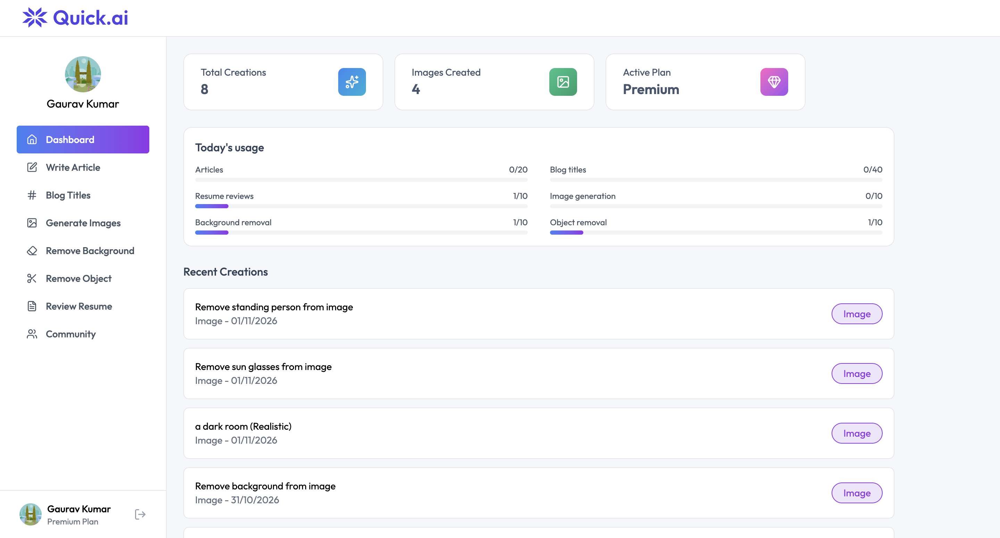
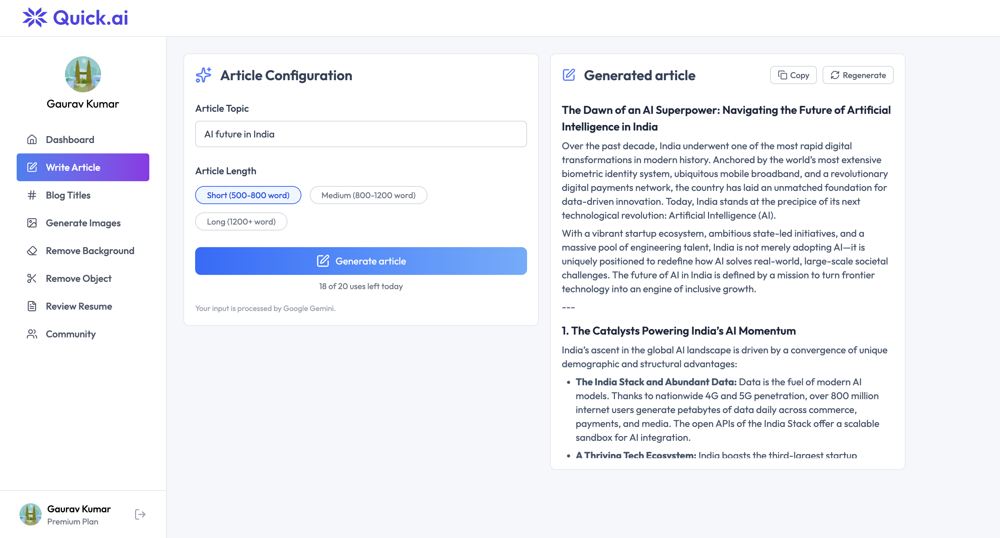
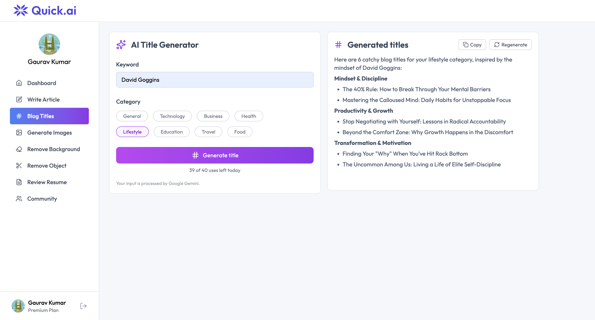
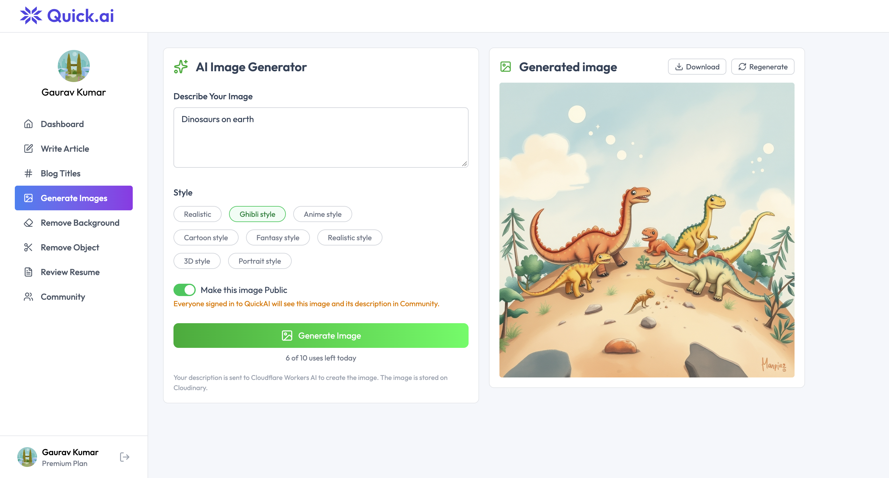
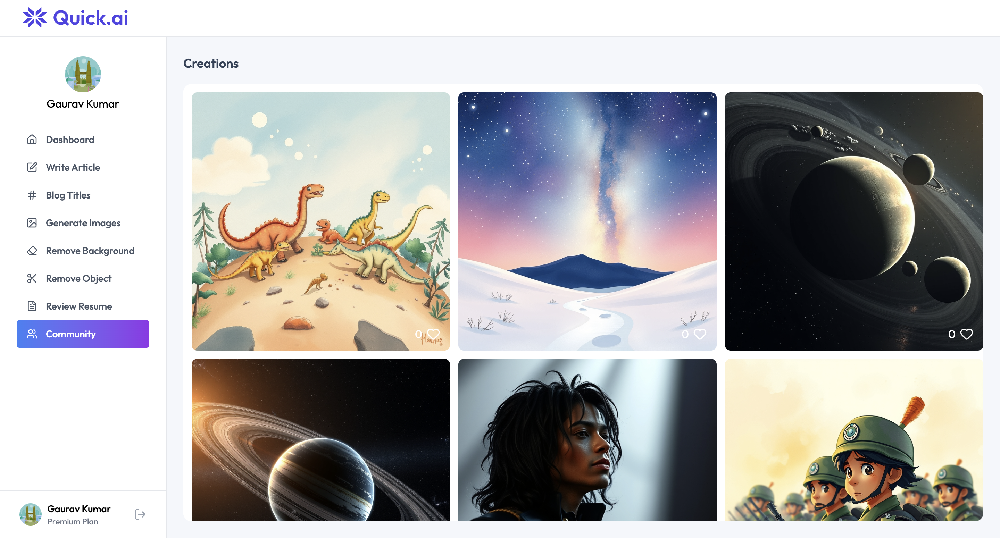
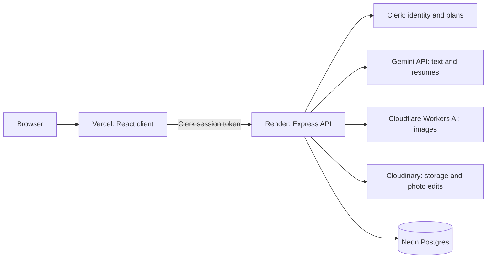
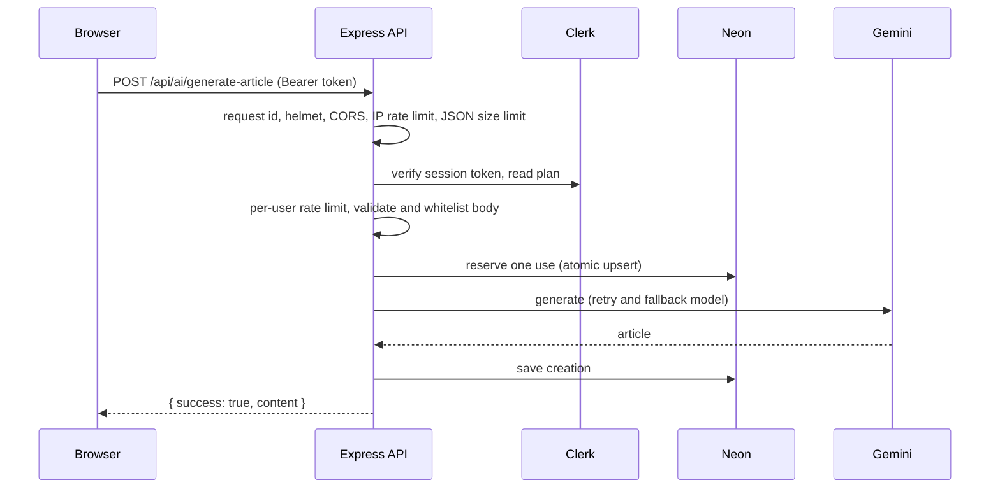
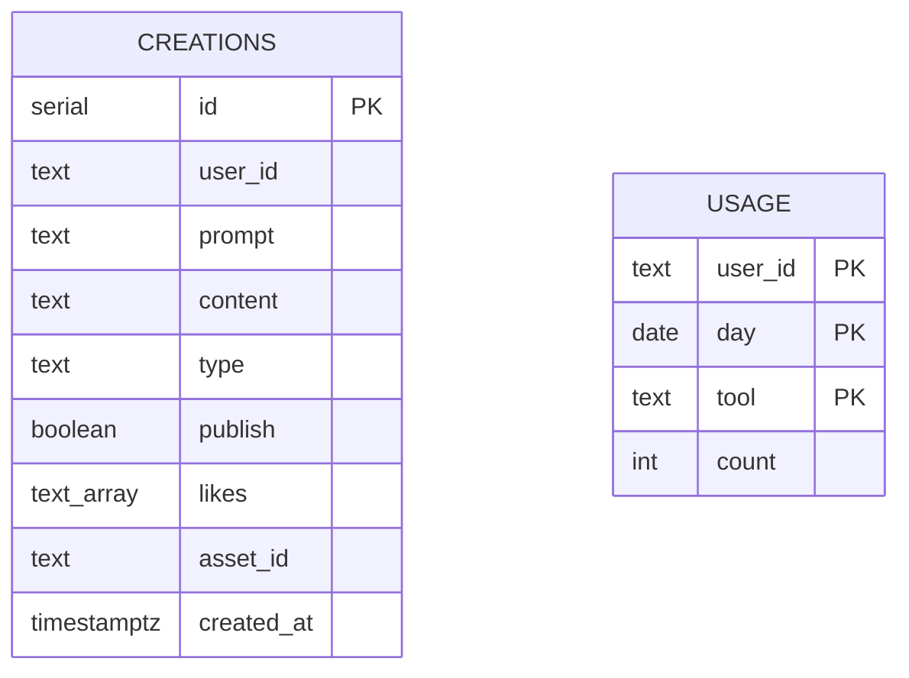
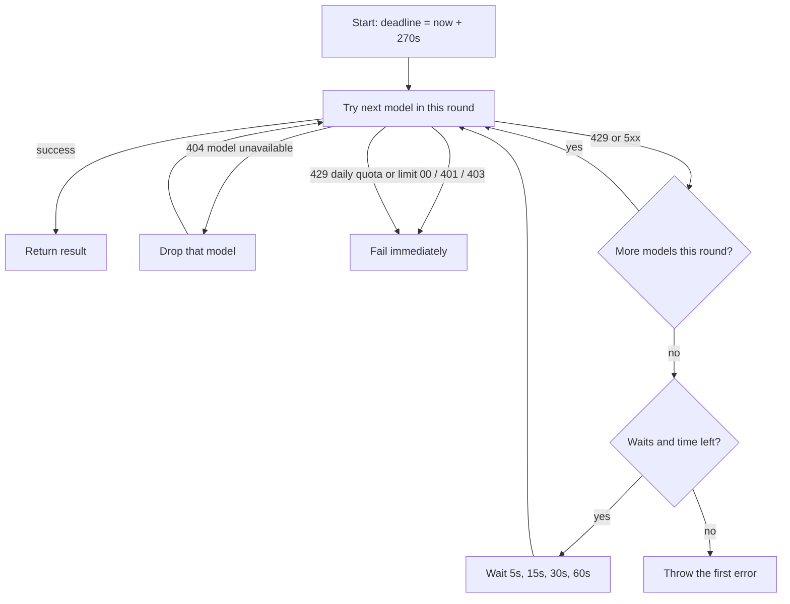

# Quick.ai

A full-stack **AI SaaS web app**. Users sign in, then write articles, generate blog titles and images, remove backgrounds or objects from photos, and get resume feedback. It runs entirely on **free tiers** and is built the way a real product is: authentication, plans, per-user limits, validation, retries when the AI is overloaded, structured logs, tests and a deploy pipeline.

> **Live demo:** `https://quick-ai-six-teal.vercel.app/`

## Screenshots

<table>
  <tr>
    <td align="center">
      <br />
      <sub><b>Dashboard</b></sub>
    </td>
    <td align="center">
      <br />
      <sub><b>Write Article</b></sub>
    </td>
  </tr>
  <tr>
    <td align="center">
      <br />
      <sub><b>Blog Titles</b></sub>
    </td>
    <td align="center">
      <br />
      <sub><b>Generate Image</b></sub>
    </td>
  </tr>
  <tr>
    <td align="center">
      <br />
      <sub><b>Community Posts</b></sub>
    </td>
  </tr>
</table>

**30-second pitch.** *"Quick.ai is a React + Express app with six AI tools. The browser never talks to an AI provider; it calls my API, which checks the user's identity and plan, reserves a daily quota atomically in Postgres, calls Gemini, Cloudflare or Cloudinary with retry and fallback, saves the result and returns it. The interesting engineering is making free, unreliable AI APIs behave like a dependable product: atomic quotas with refunds, shared-budget caps, patient retries, fail-fast on quota errors, and safe handling of untrusted input."*

---

## Table of contents
1. [Features](#1-features)
2. [Tech stack and why](#2-tech-stack-and-why)
3. [Architecture](#3-architecture)
4. [Project structure](#4-project-structure)
5. [Database design](#5-database-design)
6. [API reference](#6-api-reference)
7. [Authentication, plans and limits](#7-authentication-plans-and-limits)
8. [Key engineering decisions](#8-key-engineering-decisions)
9. [Security](#9-security)
10. [Reliability and error handling](#10-reliability-and-error-handling)
11. [Frontend design](#11-frontend-design)
12. [Testing](#12-testing)
13. [Run it locally](#13-run-it-locally)
14. [Environment variables](#14-environment-variables)
15. [Deployment](#15-deployment)
16. [Scaling: what breaks first and how I would fix it](#16-scaling-what-breaks-first-and-how-i-would-fix-it)
17. [Known limitations and trade-offs](#17-known-limitations-and-trade-offs)
18. [Problems I hit and what I learned](#18-problems-i-hit-and-what-i-learned)
19. [Interview Q&A](#19-interview-qa)
20. [Resume bullets](#20-resume-bullets)

---

## 1. Features

| Tool | What it does | Powered by |
|---|---|---|
| Write Article | Markdown article of a chosen length | Gemini (text) |
| Blog Titles | Six titles for a keyword and category | Gemini (text) |
| Review Resume | Strengths, gaps, fixes and ATS tips from a PDF. The resume is never stored | Gemini (reads the PDF directly) |
| Generate Images | Image from a description and a style, optionally public | Cloudflare Workers AI (FLUX.1 schnell), stored on Cloudinary |
| Remove Object | Erases a named object from a photo | Cloudinary Generative Remove |
| Remove Background | Transparent-background PNG | Cloudinary background removal |
| Dashboard | History, stats, today's usage per tool, delete, publish or unpublish | Neon Postgres |
| Community | Public images with likes, paginated | Neon Postgres |

Platform features: Free and Premium plans (Clerk Billing), daily per-tool limits, copy / download / regenerate, before-and-after view, drag-and-drop uploads with preview, pagination, a demo mode that runs without a backend, accessibility basics (labels, keyboard-usable controls, live regions).

## 2. Tech stack and why

| Layer | Choice | Why this and not something else |
|---|---|---|
| UI | React 19 + Vite 8 + Tailwind CSS 4 | Fast dev loop, component model fits tool pages that share one layout |
| Routing | React Router 7 | Nested routes: `/ai` layout with sidebar and an `<Outlet />` |
| Auth + plans | Clerk (`@clerk/react`, `@clerk/express`) | Hosted sign-in, sessions, JWT verification and subscription plans, so I do not hand-roll password storage |
| API | Node 22 + Express 5 | Simple, well understood, async errors reach the error handler natively in Express 5 |
| DB | Neon (serverless Postgres) via `@neondatabase/serverless` | Free tier, real SQL (atomic upserts, arrays, indexes), HTTP driver means no connection pool to manage |
| Text AI | Google Gemini (`@google/genai`) | Free tier, reads PDFs natively, so no PDF parsing library |
| Image generation | Cloudflare Workers AI, FLUX.1 schnell | Gemini image models need billing; Cloudflare has a free daily allowance |
| Image storage and editing | Cloudinary | CDN-backed URLs, background removal and generative remove in one service |
| Hosting | Vercel (client), Render (API), Neon (DB) | All have free tiers |
| Testing | `node:test` (built in) | Zero extra dependencies |

## 3. Architecture



**One request end to end** (Write Article):



If anything after the reservation fails, the use is **refunded**.

**Why the browser never calls an AI provider:** keys would be exposed, quotas could not be enforced per user, and prompts could not be controlled.

## 4. Project structure

```
QuickAI/
├── client/
│   ├── vercel.json                SPA rewrite so /ai/community survives a refresh
│   └── src/
│       ├── api/          useApi.js (fetch wrapper), demo.js (sample data, no backend)
│       ├── hooks/        useRun, useCreations (pagination), useUsage
│       ├── components/   ToolShell, FileInput, BeforeAfter, Chips, Md, Status, Sidebar, landing sections
│       ├── pages/        Home, Layout, Dashboard, Community, six tool pages
│       └── utils/        shared styles
├── server/
│   ├── server.js                  entry: middleware order, routes, health, shutdown
│   ├── config/                    env check, db, gemini, cloudinary, limits, allowed options
│   ├── middleware/                auth, quota, rateLimit, upload, requestLogger, errorHandler
│   ├── routes/                    ai.routes.js, user.routes.js (URLs and orchestration only)
│   ├── services/                  text, cloudflare, image, creations, usage (the actual work)
│   ├── utils/                     generate (retry), fileType, waitForDerived, withTimeout, prompt, request, HttpError
│   └── tests/                     31 unit tests
├── render.yaml                    API deploy blueprint
└── README.md
```

**Layering rule:** routes validate input and call services; services talk to the outside world; middleware handles cross-cutting concerns. Pure logic (retry, file detection, validation) is in `utils/` so it can be unit-tested without a network.

## 5. Database design



- There is **no users table**: Clerk owns identity, and `user_id` stores Clerk's id.
- **`creations`**: one row per result. `content` is the text itself, or an image URL. `asset_id` is the Cloudinary id used to delete the file. `likes` is a `text[]` of user ids (a tradeoff: simple, but not for huge like counts).
- **`usage`**: one row per user, day and tool. Global shared budgets are stored in the same table under the user id `__global__`.
- **Indexes:** `(user_id, created_at desc)` for the Dashboard, `(publish, created_at desc)` for Community.
- **Migrations:** `initDb()` runs `create table if not exists` and `alter table ... add column if not exists` at startup. Fine for a small project; a real team would use a migration tool.

## 6. API reference

All `/api/*` routes need `Authorization: Bearer <Clerk session token>`. Success: `{ success: true, ... }`. Failure: `{ success: false, message, requestId }`.

| Method and path | Body or query | Notes |
|---|---|---|
| `POST /api/ai/generate-article` | `{ topic, length }` | length must be 800, 1200 or 1600 |
| `POST /api/ai/generate-blog-title` | `{ keyword, category }` | category from a fixed list |
| `POST /api/ai/generate-image` | `{ prompt, style, publish }` | style from a fixed list |
| `POST /api/ai/remove-image-background` | form: `image` | PNG, JPEG, WebP, max 5 MB |
| `POST /api/ai/remove-image-object` | form: `image`, `object` | object: letters, numbers, spaces, max 40 chars |
| `POST /api/ai/resume-review` | form: `resume` | PDF, max 5 MB, never stored |
| `GET /api/user/get-user-creations?page=` | | 12 per page, plus `hasMore` and `stats` |
| `GET /api/user/get-published-creations?page=` | | returns `like_count` and `liked`, never other users' ids |
| `GET /api/user/get-usage` | | today's `{ used, limit }` per tool |
| `POST /api/user/toggle-like-creation` | `{ id }` | only on published items |
| `POST /api/user/toggle-publish` | `{ id }` | owner only, images only |
| `POST /api/user/delete-creation` | `{ id }` | owner only, also deletes the Cloudinary file |
| `GET /` and `GET /health` | | `/health` also checks the database |

**Status codes used:** 400 bad input, 401 not signed in, 404 not found, 413 file too large, 429 limit or quota, 502 bad or empty upstream reply, 503 upstream busy or unavailable, 504 AI took too long.

## 7. Authentication, plans and limits

- **Sign-in:** Clerk. The client attaches the session token with `getToken()`. The server's `clerkMiddleware()` verifies it, and `requireUser` rejects requests without a user.
- **Plan check:** `has({ plan: 'premium' })` on every request. The plan is **never** sent by the client, so it cannot be faked.
- **Daily limits (per user):**

| Tool | Free | Premium |
|---|---|---|
| Articles | 5 | 20 |
| Blog titles | 10 | 40 |
| Resume reviews | 3 | 10 |
| Image generation | 3 | 10 |
| Background removal | 2 | 10 |
| Object removal | 3 | 10 |

- **Shared free budgets (all users together):** image generation `CLOUDFLARE_DAILY_LIMIT` (default 100 a day, against Cloudflare's 10,000 Neurons a day), background and object removal `CLOUDINARY_MONTHLY_LIMIT` (default 20 a month, against Cloudinary's small credit pool).
- Premium means higher limits, not extra tools. Both plans can use all six tools.

## 8. Key engineering decisions

**1. Atomic quota with refund (no race conditions).**
Checking "is the count under the limit?" and then incrementing is a race: two parallel requests both pass. Instead one SQL statement does it:
```sql
insert into usage (user_id, day, tool, count) values ($1, $2::date, $3, 1)
on conflict (user_id, day, tool)
do update set count = usage.count + 1 where usage.count < $4
returning count
```
If no row is returned, the limit is reached. `withQuota()` reserves, runs the work, and **releases the use if the work throws**, so failed requests do not cost the user.

**2. Patient retry with a fallback model** (`utils/generate.js`).
Free AI endpoints are often overloaded (503) or rate-limited (429).


Each round tries the main model, then a lighter fallback (they are often not overloaded at the same time). Errors that waiting cannot fix fail at once. A 429 that mentions a daily quota or `limit: 0` also fails at once, so the user is not made to wait. The whole call is capped at 4.5 minutes. The logic takes an injectable `call`, `sleep` and `now`, so 9 unit tests run in milliseconds with a fake clock.

**3. The server builds every prompt.**
The client sends only structured fields (`topic`, `length`, `category`, `style`). The server whitelists the values, wraps free text in tags (`<topic>...</topic>`), strips `<` and `>` so a user cannot close the tag, and sets a system instruction saying tagged text is untrusted data. This reduces prompt injection and also stops clients from sending arbitrary prompts to a paid model.

**4. Validate files by their real bytes.**
Browsers report a file type that anyone can fake. `utils/fileType.js` checks magic numbers (`%PDF-`, the PNG signature, JPEG `FF D8 FF`, WebP `RIFF....WEBP`), then sets the mimetype from the detected type. Uploads live in memory only (multer memory storage, 5 MB cap), never on disk.

**5. Object removal with an asynchronous derived image.**
Cloudinary's Generative Remove can only be applied through the delivery URL. The server uploads the photo, builds a **signed** URL with `gen_remove:prompt_<object>`, then requests it itself and polls while Cloudinary answers 423 (still processing). The browser only ever receives a finished image. On failure the uploaded original is deleted.

**6. Privacy by design.**
Resumes are sent to Gemini and not stored. The Community endpoint returns `like_count` and a `liked` boolean, never the list of user ids. Every mutation filters by `user_id`.

**7. Fail fast on bad configuration.**
`validateEnv.js` checks required settings at startup and prints exactly what is wrong (for example, "paste only the postgresql:// URL, not the psql command"), instead of crashing later with a vague error.

**8. Pagination with `limit + 1`.**
Each list fetches 13 rows to show 12, so `hasMore` is known without a second `count` query.

**9. Optimistic UI.**
The like button updates immediately and is rolled back if the request fails.

**10. Observability.**
Every request gets a UUID (`X-Request-Id`, also returned in error bodies) and one JSON log line (method, path, status, milliseconds, user). Retries and upstream errors are logged as structured warnings, so a support question can be traced to one line.

## 9. Security

| Threat | Mitigation |
|---|---|
| SQL injection | Neon tagged-template queries send values as parameters, never string-concatenated |
| Broken access control (IDOR) | Every update and delete includes `where user_id = $1`; likes only work on published items |
| Prompt injection | Whitelisted fields, tagged untrusted text, system instruction, output rendered as safe Markdown |
| XSS | React escapes by default; the Markdown component builds React elements and never uses `dangerouslySetInnerHTML` |
| CSRF | Auth uses a bearer token in a header, not a cookie, so cross-site form posts carry no credentials |
| CORS abuse | Allowlist from `CLIENT_ORIGINS` |
| Abuse and cost | IP rate limit (120 a minute), per-user AI rate limit (10 a minute), daily quotas, shared budgets, 100 KB JSON limit, 5 MB upload limit |
| Malicious uploads | Magic-byte validation, memory-only storage, one file per request |
| Secret leakage | Secrets only in server `.env`; `.env` git-ignored; startup check; client has only the Clerk publishable key |
| Information leakage | Errors return generic messages plus a request id; details go to server logs |
| Clickjacking and common headers | `helmet` |
| Data exposure | Other users' ids never returned; Community shows counts only |

**Honest caveat:** free-tier AI providers may use inputs to improve their products. The UI states which provider processes each tool's data.

## 10. Reliability and error handling

- **Central error handler** maps errors to safe messages and status codes and logs upstream details.
- **Timeouts:** server-side AI cap 4.5 minutes; Cloudflare call 60 seconds with up to 2 retries on 5xx or network errors (3s, 8s); Cloudinary derived-image polling up to 8 attempts, 3 seconds apart; browser request cap 5.5 minutes.
- **Refunds:** a failed request never consumes the user's daily use.
- **Cold starts:** the free API host sleeps when idle. The UI shows "the server may be waking up" after 8 seconds, and `GET /` is a cheap wake-up ping.
- **Graceful shutdown:** `SIGTERM` closes the HTTP server cleanly.
- **Health check:** `/health` verifies the database, so an uptime monitor catches real outages.

## 11. Frontend design

- **One shared layout for all tools** (`ToolShell`): form on the left, result on the right, plus usage counter, Copy / Download / Regenerate, retry on error, privacy note. Each tool page is about 30 lines.
- **Custom hooks** keep logic out of components: `useApi` (GET without a body, POST with a body, FormData for files, Clerk token, timeout, demo mode), `useRun` (loading, slow, error, result), `useCreations` (pagination and reload), `useUsage` (per-tool limits).
- **Demo mode:** with no `VITE_BASE_URL`, the app returns sample data, so the UI can be demoed without any backend.
- **Layout guard:** waits for Clerk to load, then shows the sign-in form only if there really is no user (avoids a flash).
- **Accessibility:** real `<label>` and `<button>` elements, `role='radiogroup'` chips, `aria-live` result region, `role='alert'` errors, keyboard-usable file picker and toggle.
- **Linting:** ESLint with the React hooks rules; the project lints clean.

## 12. Testing

`cd server && npm test` runs **31 unit tests** using the built-in runner, with no network and no database.

| Area | What is verified |
|---|---|
| Retry and fallback | first-try success, fallback on busy, waits of 5s and 15s, no retry on bad requests, 404 model skipped, deadline respected, 429 cap, fast fail on daily quota |
| Cloudflare client | base64 and raw replies, quota fail-fast, retry on 5xx, bad token, network errors, missing credentials |
| Cloudinary wait | success, 423 polling, failure message, never finishes, network error |
| File detection | real PDF, PNG, JPEG, WebP; disguised files rejected |
| Validation | text length, whitelists, ids, page numbers, prompt tag stripping |
| Config | env problems and warnings, plan limits |

**Not covered (honest):** SQL queries and routes against a real database (integration tests), browser end-to-end tests, and frontend component tests. Next step would be integration tests with a throwaway Postgres and Playwright for the main flows.

## 13. Run it locally

**Accounts (all free):** [Clerk](https://clerk.com), [Google AI Studio](https://aistudio.google.com), [Neon](https://neon.com), [Cloudinary](https://cloudinary.com), [Cloudflare](https://dash.cloudflare.com) (Account ID plus an API token with Workers AI permission). Node 20 or newer.

```bash
# 1. API
cd server
npm install
cp .env.example .env      # fill every value; the server tells you what is wrong
npm run dev               # http://localhost:3000   (check /health)
npm test

# 2. Client (second terminal)
cd client
npm install
cp .env.example .env      # Clerk publishable key + VITE_BASE_URL=http://localhost:3000
npm run dev               # http://localhost:5173
```

Leave `VITE_BASE_URL` empty to run the UI in demo mode. Never commit `.env` files. Clerk shows a secret key only once, when you create it.

## 14. Environment variables

**`server/.env`**

| Variable | Purpose |
|---|---|
| `PORT` | API port, default 3000 |
| `CLIENT_ORIGINS` | Comma-separated frontend URLs allowed by CORS |
| `CLERK_PUBLISHABLE_KEY`, `CLERK_SECRET_KEY` | Verify sessions and read plans (secret starts with `sk_`) |
| `GEMINI_API_KEY` | Text and resume review |
| `GEMINI_TEXT_MODEL`, `GEMINI_FALLBACK_MODEL` | Main and fallback text models (names change often, so they are config, not code) |
| `DATABASE_URL` | Neon `postgresql://...` URL only |
| `CLOUDINARY_URL` | `cloudinary://<key>:<secret>@<cloud>` |
| `CLOUDINARY_MONTHLY_LIMIT` | Shared monthly cap for background and object removal (default 20) |
| `CLOUDFLARE_ACCOUNT_ID`, `CLOUDFLARE_API_TOKEN` | Image generation (optional: without them only that tool is unavailable) |
| `CLOUDFLARE_DAILY_LIMIT` | Shared daily cap for image generation (default 100) |

**`client/.env`**

| Variable | Purpose |
|---|---|
| `VITE_CLERK_PUBLISHABLE_KEY` | Clerk publishable key (safe in the browser) |
| `VITE_BASE_URL` | API URL; empty means demo mode |

## 15. Deployment

1. **Neon:** create a project and copy the `postgresql://...` URL. Use a separate database or branch for production.
2. **Render (API):** deploy from `render.yaml` or by hand (root `server`, build `npm install`, start `npm start`, health check `/health`). Set all secrets. Set `CLIENT_ORIGINS` to the Vercel URL.
3. **Vercel (client):** root `client`; set `VITE_CLERK_PUBLISHABLE_KEY` and `VITE_BASE_URL`. `vercel.json` rewrites every path to `index.html` so refreshing `/ai/community` works.
4. **Clerk:** add the deployed URLs as allowed origins; create a plan with slug `premium` and list its features in the Clerk dashboard (the pricing cards come from there). A development instance uses test payments; check Clerk's docs before taking real money.
5. **Monitoring:** point a free uptime monitor at `/health`.
6. **Smoke test** every tool on the live site.

## 16. Scaling: what breaks first and how I would fix it

| Bottleneck | Why | Fix |
|---|---|---|
| Third-party free quotas | Shared by all users, hit long before servers do | Paid tiers, per-user budgets, caching repeated prompts, queueing |
| Long requests hold a connection (up to 4.5 min) | Ties up server capacity during AI latency | Job queue (BullMQ or a cloud queue) plus polling or server-sent events for the result |
| In-memory rate limiter | Counters are per process, so they multiply across instances | Redis-backed store |
| Single API instance on a sleeping host | Cold starts, no redundancy | Always-on plan, 2+ instances behind a load balancer (the API is stateless, so this works) |
| Offset pagination | Slower on deep pages | Keyset pagination on `(created_at, id)` |
| `likes text[]` | Large arrays, awkward to query | A `likes(creation_id, user_id)` table with a unique key and a cached count |
| `count(*)` stats on each Dashboard load | Grows with history | Denormalised counters or a materialised view |
| Startup migrations | No versioning or rollback | A migration tool (for example Drizzle, Prisma Migrate or node-pg-migrate) |

The API holds no state besides the database, so horizontal scaling is straightforward once the rate limiter and the AI calls are addressed.

## 17. Known limitations and trade-offs

- **No idempotency keys.** If a browser times out while the server still completes a request, a retry can use another daily use and create a duplicate result.
- **Quota is refunded on failure, including a failed save after a successful AI call.** The user loses the result but not the use. A safer order would persist the result first.
- **Gemini image models are not used** because they need billing; image quality and style fidelity depend on FLUX and Cloudinary, and object removal quality varies by photo.
- **Cloudinary's credit cost per AI edit is not measured**, and its free window rolls instead of resetting on the 1st, so the monthly cap is an estimate.
- **Model names churn.** The default models were retired for new accounts once already, which is why they are environment variables.
- **No automated end-to-end tests, no CI pipeline, no error-tracking service** (structured logs only).
- **Clerk development instance** is used for the demo.
- Dark mode and a full accessibility audit are not done.

## 18. Problems I hit and what I learned

1. **Clerk SDK migration:** `Protect`, `SignedIn` and `SignedOut` are replaced by `Show` in the new SDK. Reading the changelog beats guessing from an error message.
2. **A model I used was retired for new accounts** (HTTP 404). Lesson: keep model names in config and fall back automatically.
3. **"AI is busy" was actually two different errors:** 503 (overload, worth retrying) and 429 (quota). Retrying a zero quota just made users wait ~27 seconds, so quota errors now fail fast with the real message logged.
4. **Gemini image models had no free quota** for my account, so I moved image generation to Cloudflare and object removal to Cloudinary. Lesson: verify free-tier limits against your own account, not blog posts.
5. **Check-then-increment quotas are racy.** Moved to a single atomic upsert and added refunds.
6. **Misconfigured `.env` produced confusing errors** (a pasted `psql '...'` command as the database URL). Added startup validation with human-readable messages.
7. **Free hosting sleeps.** Designed the UI around it instead of hiding it.
8. **Vite refresh on nested routes 404s** without a rewrite rule, so `vercel.json` handles it.

## 19. Interview Q&A

### Product and architecture
**Q: Walk me through what happens when a user clicks Generate.**
The client sends the form with the Clerk token. The server logs a request id, applies headers, CORS and rate limits, verifies the token and plan, validates and whitelists the body, atomically reserves a daily use, calls the AI with retry and fallback, saves the result, and returns it. If any step after the reservation fails, the use is refunded.

**Q: Why a backend at all? Why not call Gemini from React?**
API keys would be public, I could not enforce per-user quotas or plans, and I could not control prompts or validate uploads.

**Q: Why this stack?**
React and Express are standard and quick to build with; Postgres gives me atomic operations and real SQL; Clerk removes the risk of writing auth myself; every service has a free tier, which was a hard constraint.

**Q: Why no ORM?**
The schema is two tables and the queries are short. The Neon driver's parameterised template strings are safe and readable. For a bigger schema I would add an ORM or query builder plus migrations.

**Q: Why Express 5?**
Rejected promises in async handlers go to the error middleware automatically. I still wrap handlers once in `wrap()` so the pattern is explicit and independent of the version.

### Concurrency and data
**Q: How do you stop a user exceeding their limit with parallel requests?**
One `INSERT ... ON CONFLICT DO UPDATE ... WHERE count < max RETURNING` statement. Postgres serialises it per row, so only requests under the limit get a row back. No application-level lock is needed.

**Q: What if the AI call fails after reserving?**
`withQuota` catches the error, decrements the counter (never below zero) and rethrows.

**Q: How do the shared budgets work?**
The same table stores a row under the pseudo-user `__global__` with a daily or monthly key. A request must reserve both its user quota and the global one, and release both on failure.

**Q: Why `limit + 1` pagination?**
It tells me whether another page exists without a separate count query. It is offset-based, which is fine at this size; I would use keyset pagination at scale.

**Q: How do likes work, and what are the downsides?**
A `text[]` on the creation with an atomic `CASE` update that adds or removes the user id. It is simple, but large arrays are inefficient and hard to query, so at scale I would use a join table with a unique constraint.

**Q: Where is the user table?**
There is none. Clerk owns identity; I store its user id as text. That avoids syncing users, at the cost of not being able to join on user profile data.

### Reliability
**Q: Explain your retry strategy.**
Rounds of trying each model (main, then fallback), waiting 5, 15, 30 and 60 seconds between rounds, capped at 4.5 minutes overall. Bad requests and bad keys fail immediately; daily or zero quotas fail immediately with the real message; a missing model is dropped for the request.

**Q: Why not retry 429s forever?**
A 429 can mean a per-minute limit (clears soon) or a daily or zero quota (never clears in the request). Waiting on the second kind just makes the user wait for nothing, so I detect it and fail fast, and cap repeated 429s.

**Q: How did you test time-based retry logic quickly?**
The function takes injected `call`, `sleep` and `now`. Tests pass a fake clock where sleeping just advances a counter, so a 110-second retry schedule runs in milliseconds.

**Q: What happens on a cold start?**
The first request can take about a minute. The UI shows a waking-up message after 8 seconds, and there is no hard failure because the browser limit is longer than the server's cap.

**Q: What are the failure modes you did not fully solve?**
No idempotency keys (a timed-out retry can double-spend a use), and a failed save after a successful AI call loses the result. Both are in the limitations list.

### Security
**Q: How do you handle prompt injection?**
I cannot eliminate it, but I reduce it: the client cannot send prompts, only whitelisted fields; free text is wrapped in tags with angle brackets stripped; a system instruction marks tagged text as untrusted; and output is rendered as safe Markdown, so a hijacked response cannot run script.

**Q: Why is CSRF not a concern?**
Authentication is a bearer token set explicitly in a header by my code. Browsers do not attach it automatically to cross-site requests, unlike cookies.

**Q: How do you prevent XSS?**
React escapes by default, and my Markdown renderer creates React elements from parsed lines instead of injecting HTML strings.

**Q: How do you stop IDOR?**
Every query that touches a creation includes the caller's `user_id`, or, for likes, requires `publish = true`. The ids come from the verified token, never from the request body.

**Q: How do you validate uploads?**
Size cap, one file, memory-only storage, and a magic-byte check on the real content. The browser-reported type is ignored and then overwritten with the detected one.

**Q: Where are secrets kept?**
Only in the server's environment (a git-ignored `.env` locally, the host's secret store in production). The server refuses to start if they are missing or malformed. The client holds only the publishable key, which is designed to be public.

**Q: What would you do if a key leaked?**
Create a new key, update the host environment, delete the old key, and check logs for misuse.

### Frontend
**Q: How is state managed?**
Local component state and custom hooks; there is no global store because pages do not share much state. Server data is fetched by hooks (`useCreations`, `useUsage`), and `useRun` models a request lifecycle (loading, slow, error, result).

**Q: What is optimistic UI and where do you use it?**
Updating the interface before the server confirms. The like button flips instantly and rolls back if the request fails.

**Q: How did you keep six tool pages consistent?**
A shared `ToolShell` holds layout, limits display, actions and error handling. Pages only declare their form fields and call the API.

**Q: How do you handle large lists?**
Pagination with a Load more button, and lazy-loaded images.

### Scaling and operations
**Q: How would you scale this to 100,000 users?**
The API is stateless, so run several instances. Move the rate limiter to Redis, long AI calls to a job queue with polling or SSE, pagination to keyset, likes to a join table, and add paid AI tiers and caching. See section 16.

**Q: How would you monitor it?**
Structured JSON logs with request ids (done), `/health` with an uptime monitor, and an error tracker such as Sentry plus metrics for AI latency and error rate (next step).

**Q: How would you set up CI/CD?**
A GitHub Action that runs `npm test` and `npm run lint` on every pull request, with Vercel and Render auto-deploying from `main`. Add a preview environment per pull request.

**Q: How do you control costs?**
Per-user daily limits, shared global caps sized below each provider's free allowance, request size limits, rate limits, and refunds only on failure. There are no paid services in the stack.

### Behavioural
**Q: Hardest bug or problem?**
Free AI APIs failing in ways that looked the same ("busy") but needed opposite handling: overload (wait and retry) versus quota (fail fast and tell the user). I read the real error bodies, separated the cases, covered both in tests, and moved image tools to providers whose free tiers actually work.

**Q: What would you do differently?**
Add integration tests and CI from day one, use a migration tool, persist results before refunding, and add idempotency keys.

**Q: What are you proudest of?**
Treating unreliable third-party services as a design constraint: atomic quotas with refunds, retry with fallback, input validation, and a test suite that runs without a network.

## 20. Resume bullets

- Built **Quick.ai**, a full-stack AI SaaS (React 19, Express 5, Postgres, Clerk) with six AI tools, Free and Premium plans, a user dashboard and a public community gallery, deployed on free tiers (Vercel, Render, Neon).
- Designed **atomic per-user and global usage quotas** with a single SQL upsert and automatic refunds, preventing race-condition overuse of free AI quotas.
- Implemented **retry with model fallback** and fail-fast quota handling for overloaded AI APIs (bounded at 4.5 minutes), with unit tests driven by an injectable fake clock.
- Hardened the API against **prompt injection, IDOR, malicious uploads and abuse** using server-built whitelisted prompts, magic-byte file validation, ownership-scoped queries and layered rate limits.
- Integrated **Gemini, Cloudflare Workers AI and Cloudinary**, including server-side handling of asynchronous image transformations.
- Added **structured logging with request ids, startup config validation, health checks**, and 31 automated tests; kept the frontend lint-clean with a reusable component and hook architecture.

---

*Built by [Your Name]. Replace the placeholders (live URL, screenshots, name) before publishing.*
